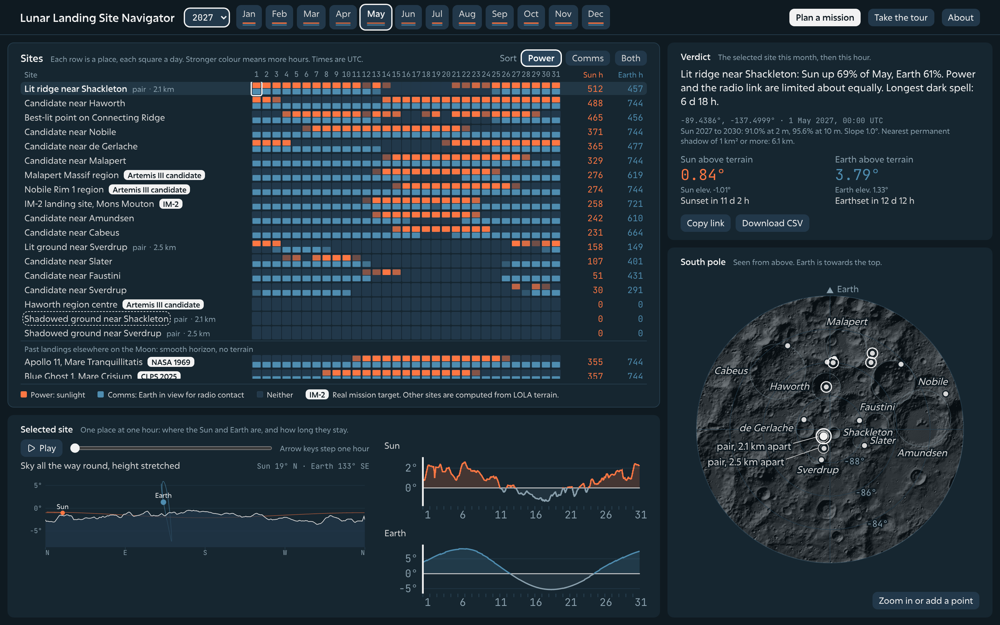

# Lunar Landing Site Navigator

Where to land at the Moon's south pole, and when. Compare 18 sites by the hours they get
sunlight (power) and a line of sight to Earth (radio), for every hour from 2027 to 2040.

- **Live site:** https://www.moonfrom.earth/
- **Demo deck (7 slides):** https://www.moonfrom.earth/deck.pdf, the same file as [`public/deck.pdf`](public/deck.pdf)
- **Challenge:** [Lunar Landing Site Navigator](https://www.spaceappschallenge.org/2026/challenges/lunar-landing-site-navigator/), NASA Space Apps Challenge 2026
- **Team:** Team SBB, Athens local event



## What it does

- **Compare sites.** One row per site, one square per day: orange for Sun, blue for Earth
  in view. Sort by power, comms or both.
- **See the reason.** Pick a site and an hour to see the terrain skyline all the way round,
  with the Sun and Earth at their real direction and height. Play time forward and watch
  them rise and set.
- **Plan a mission.** Say how long the mission stays and how much Sun, Earth and darkness it
  can take. Every site is checked hour by hour and ranked by the days it could land.
- **Add your own point**, anywhere on the Moon, and compare it with five past landings.
- **Take the tour.** Five steps through one story: two places 2.1 km apart, one sunlit all
  of January 2027 and one with no Sun at all.

[`PRODUCT.md`](PRODUCT.md) lists every feature.

## How it works

1. **NASA/JPL Horizons** gives the direction of the Sun and Earth from each site, every hour.
2. **NASA LRO LOLA** elevation maps (5 m and 30 m) give the terrain. We trace the skyline
   around each site in 360 directions, out to 150 km, from 2 m above the ground.
3. A body counts as visible when any part of its disc is above that skyline. There is no
   atmosphere, so no refraction.

The Python in `data/` does this once and writes JSON to `public/data/`. The website reads
those files and never calls Python. The file shapes are in the Contract section of
[`AGENTS.md`](AGENTS.md).

## How we checked it

We compared our Sun percentages with a published simulation at four points on Connecting
Ridge (Gläser et al., EPSC 2014).

| Observer height | Ours, 2027 | Published | Gap |
| --- | --- | --- | --- |
| 10 m, spot 4 | 95.97% | 95.66% | +0.31 |
| 10 m, spot 3 | 95.95% | 95.6% | +0.35 |
| 2 m, spot 2 | 86.66% | 92.3% | -5.64 |
| 2 m, spot 1 | 83.92% | 92.0% | -8.08 |

The 10 m points agree within 0.4 percentage points. The 2 m points do not, and we have not
found out why. The full comparison is in [`data/KNOWN-ANSWERS.md`](data/KNOWN-ANSWERS.md).

## What it does not tell you

- It is visibility geometry only: not a power budget, a thermal model or a radio link budget.
- The computed sites are points our scan found, not official landing sites.
- Custom points and past landings use a smooth Moon with no terrain, so they are never
  ranked against the 18 terrain-aware sites.
- Samples are hourly, and terrain errors are not carried through to the results.

## Repository map

| Path | What is in it |
| --- | --- |
| `app/`, `components/`, `lib/` | The website: Next.js, TypeScript, Tailwind. Tests sit next to the code in `lib/*.test.ts`. |
| `data/` | Python that builds the data from Horizons and LOLA, with its tests and method notes ([`data/README.md`](data/README.md)). |
| `public/data/` | The built JSON the website reads: one folder per year, 2027 to 2040. |
| `public/deck.pdf` | The demo deck. |
| `story/` | [`sources.md`](story/sources.md): everything we used and credit. [`submission.md`](story/submission.md): the project page text. `notes/`: working notes from the weekend. |
| `docs/evidence/` | Screenshots of the live site, taken signed out. |
| `AGENTS.md`, `CLAUDE.md` | The rules our AI coding agents and the review bot read: who owns which folder, and the data contract. |
| `.github/` | The check and the AI review that run on every pull request. |

## Run it

```bash
npm install
npm run dev      # http://localhost:3000
npm run check    # eslint, typecheck, 134 tests
```

The data is already built and committed. To rebuild or test it, see
[`data/README.md`](data/README.md).

## Sources and AI use

Every source, with what it is used for, is in [`story/sources.md`](story/sources.md).

We built this with AI coding tools and say so. Claude Code wrote most of the code and tests
from our instructions and reviews each pull request. ChatGPT and Codex helped draft the
submission text. The numbers on the site come from NASA data and plain arithmetic, not from
an AI model. The details are in the AI assistance section of the sources file.

## Licence

AGPL-3.0-only. See [`LICENSE`](LICENSE).
